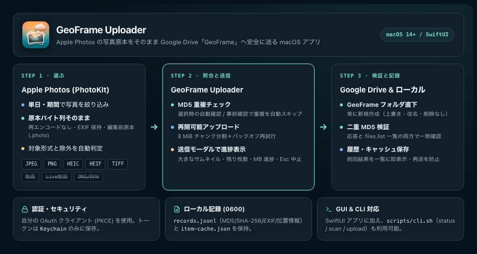
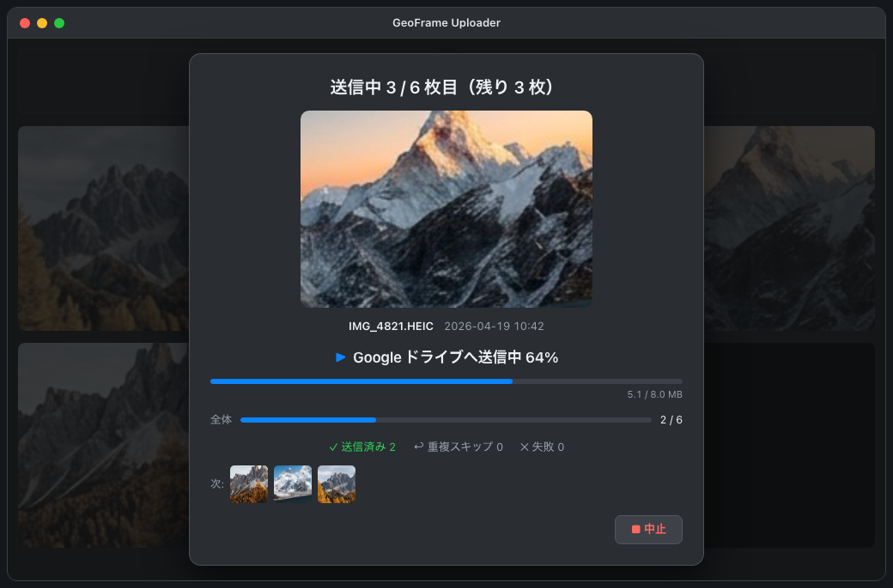

# GeoFrame Uploader

**Apple Photos の写真原本を、そのまま Google ドライブ「GeoFrame」へ。**

GeoFrame Uploader は、macOS の「写真」アプリ（PhotoKit）から日付で選んだ写真の**原本バイト列を一切加工せず**、Google ドライブ のマイドライブ直下フォルダ「GeoFrame」へ直接アップロードする macOS ネイティブアプリ（SwiftUI + CLI）です。

**紹介ページ（LP）: https://ysogabe.github.io/geoframe-photo-uploader/**



## なぜ作ったか

Apple Photos から写真を書き出してフォトフレームや写真サーバーへ送るとき、環境によっては再エンコードされて元のバイト列・EXIF が変わったり、同じ写真を何度も送ってしまったりします。

GeoFrame Uploader は [GEOFRAME](https://ysogabe.github.io/geoframe/)（Google ドライブ「GeoFrame」フォルダを定期取り込みするセルフホスト写真管理基盤）向けの送り手として、**「PhotoKit の原本バイト列そのまま」「MD5 による重複スキップ」「送信後の二重検証」** を徹底しています。

## 何ができるか

- **原本バイト列をそのまま送信**: `PHAssetResource` の `.photo` リソースだけを取り出して送ります。再エンコードはせず、EXIF（撮影日時・位置情報など）も元のまま残ります。編集済みの写真でも編集前の原本を送り、Live Photo は静止画だけを送ります。
- **対象形式を自動で仕分け**: JPEG / PNG / HEIC / HEIF / TIFF を送信対象とし、動画・Live Photo の動画部分・DNG / RAW・GIF などは「対象外」として理由付きで除外します。
- **2ヶ月見開き・大判レンジカレンダー ＆ 場所・時間枠で自動グループ表示**: クイックプリセット（`今日` / `昨日` / `直近3日` / `直近7日` / `直近30日` / `今月` / `先月`）や2ヶ月見開きの大判カレンダー（各日にローカルの送信済み・確認済み履歴件数をドット表示、「履歴のある月」への直接ジャンプ付き）で期間を選び（同日2回クリックで単日指定も可能）、撮影時刻の空き（15 / 30 / 60 分）と移動距離（100 m / 300 m / 1 km）ごとにセクションを自動で区切って表示します。「地名を表示」オン時はセクション代表座標（約 100 m 単位に丸めた座標）を逆ジオコーディングして地名を表示し、枠単位で一括選択できます。
- **似た写真の自動まとめ ＆ ★ 推奨を自動選択（`ysogabe/geoframe` 方式）**: 512 px サムネイルだけを使って iCloud から原本を落とさずに 64-bit pHash と品質指標（鮮明度・露出・コントラスト・白飛び/黒つぶれ）を解析し、バーストや似た写真をグループ化します。グループ内の最高評価写真（お気に入り最優先）や単体の良好な写真を **「推奨を自動選択」** で一括選択でき、点線枠の **「見比べて選ぶ」** からキーボード操作（`←/→`・`Space`・`1〜9`・`Enter`）付きで横並び比較できます。`Shift + クリック` での範囲選択にも対応します。
- **選択時の自動重複確認と手動確認**: 原本の MD5 を Google ドライブのフォルダ内の `md5Checksum` と照合し、既にある写真や選択内で重複する写真を自動でスキップ（または選択解除）します。キャッシュに MD5 があれば iCloud からの再取得を省略します。
- **上書きしない安全な再開可能アップロード**: 8 MiB チャンクの再開可能アップロードで常に新規ファイルとして作成します（既存ファイルの上書き・改名・削除はしません）。送信後は API 応答と再取得した `files.list` の両方で `md5Checksum` の一致を検証します。
- **送信中の状態がひと目でわかるパネル**: 送信ボタンを押すと大きなサムネイル・処理段階・MB 進捗・残り枚数・累計件数・次に送る写真を確認でき、`Esc` でいつでも中止できます。
- **前回の結果を記憶 & ローカルキャッシュ**: 送信結果・MD5 / SHA-256 を `records.jsonl` と `item-cache.json`、品質スコア・pHash を `quality-cache.json`、逆ジオコーディング地名を `place-cache.json`、位置補完データを `location-overrides.json`（いずれも権限 `0600`）に保存し、次回読み込み時から高速に再表示します。
- **位置情報がない写真への補完（既存位置の上書きなし）**: 原本 EXIF や写真アプリの位置情報が無い写真に対し、同日・近接セクションの推定位置、地名検索、地図クリック、座標入力から位置を補完できます。送信時は原本バイト列を変えずに Drive カスタム `properties`（`geoframe.lat` / `geoframe.lon`）として付与し、Apple Photos 側への書き戻し（オプション）も選べます。
- **CLI でも使える**: `.app` バンドル経由で `status` / `scan` / `auth` / `upload` / `signout` を実行できます。

## 画面のイメージ

> 以下は実際の SwiftUI 画面構成をもとに作成した見本画像です（撮影写真はサンプル画像・フォルダ ID は仮の値です）。

### 場所・時間枠グループ ＆ 推奨自動選択（v0.2）


### 類似写真の見比べパネル（v0.2）


### 一覧・自動重複確認画面


### 送信中モーダルパネル


## すぐ試す

動作要件: **macOS 14 以降** / **Xcode（または Command Line Tools）と Swift 5.9+**（ソースからビルド） / **自分用の Google Cloud OAuth クライアント**

```sh
cd apps/GeoFrameUploader
swift build
swift test
scripts/build-app.sh
open .build/GeoFrameUploader.app
```

CLI は `apps/GeoFrameUploader/scripts/cli.sh` から実行します（詳しくは [使い方](docs/USAGE.md)）。

初回の Google ドライブ接続には、ご自身の Google Cloud プロジェクトで「デスクトップ アプリ」用 OAuth クライアント JSON を作成し、`~/Library/Application Support/GeoFrameUploader/oauth-client.json` に配置する必要があります。詳しい手順は [Google Cloud 側の準備](docs/google-cloud-setup.md) をご覧ください。

## GEOFRAME / Miharashi とのつながり

1. **GeoFrame Uploader**（このリポジトリ）: Apple Photos の原本を Google ドライブ「GeoFrame」フォルダへ送信
2. **[GEOFRAME](https://ysogabe.github.io/geoframe/)**: Google ドライブ「GeoFrame」の写真を取り込んで SQLite に索引・整理
3. **[Miharashi](https://ysogabe.github.io/miharashi/)**: 整理された写真をキオスク画面に表示

## もっと詳しく

ビルド、署名、GUI / CLI の詳細な使い方、モジュール設計、認証方式の判断理由は [docs/](docs/README.md) にまとめています。
