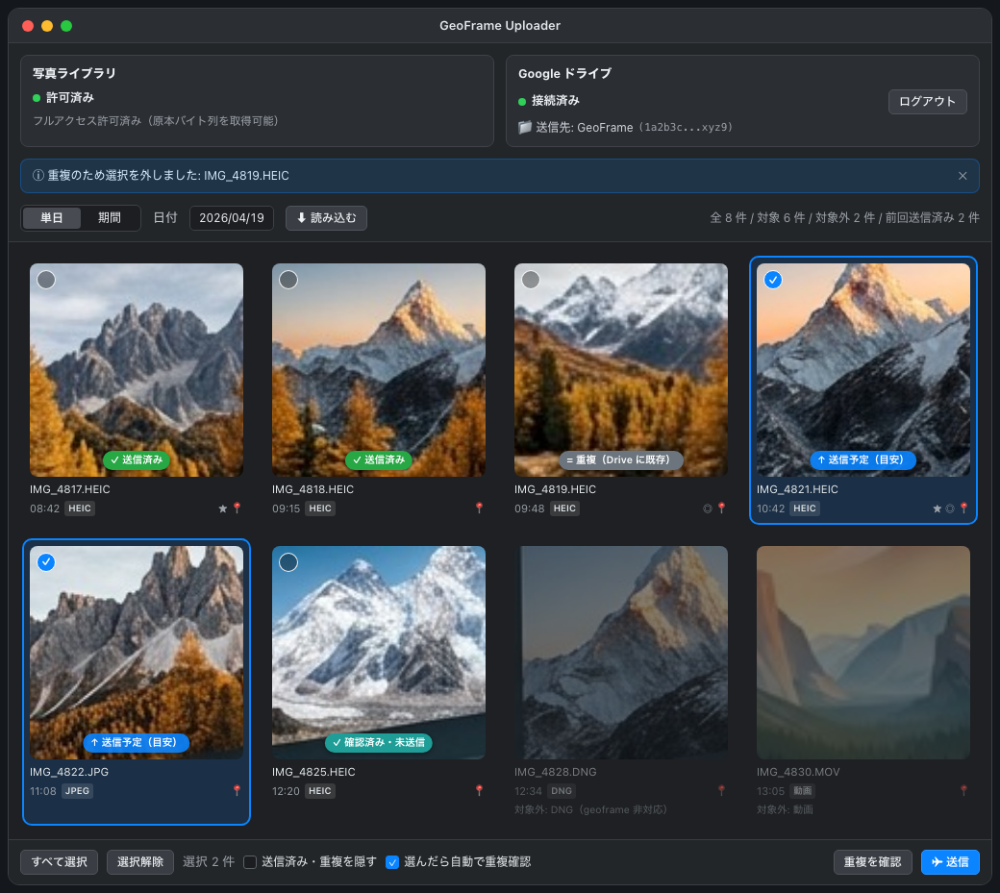

# GeoFrame Uploader

**Apple Photos の写真原本を、そのまま Google Drive「GeoFrame」へ。**

GeoFrame Uploader は、macOS の「写真」アプリ（PhotoKit）から日付で選んだ写真の**原本バイト列を一切加工せず**、Google Drive のマイドライブ直下フォルダ「GeoFrame」へ直接アップロードする macOS ネイティブアプリ（SwiftUI + CLI）です。

**紹介ページ（LP）: https://ysogabe.github.io/geoframe-photo-uploader/**


## なぜ作ったか

Apple Photos から写真を書き出してフォトフレームや写真サーバーへ送るとき、環境によっては再エンコードされて元のバイト列・EXIF が変わったり、同じ写真を何度も送ってしまったりします。

GeoFrame Uploader は [GEOFRAME](https://ysogabe.github.io/geoframe/)（Google Drive「GeoFrame」フォルダを定期取り込みするセルフホスト写真管理基盤）向けの送り手として、**「PhotoKit の原本バイト列そのまま」「MD5 による確実な重複スキップ」「送信後の二重検証」** を徹底しています。

## 何ができるか

- **原本バイト列をそのまま送信**: `PHAssetResource` の `.photo` リソースだけを取り出して送ります。再エンコードはせず、EXIF（撮影日時・位置情報など）も元のまま残ります。編集済みの写真でも編集前の原本を送り、Live Photo は静止画だけを送ります。
- **対象形式を自動で仕分け**: JPEG / PNG / HEIC / HEIF / TIFF を送信対象とし、動画・Live Photo の動画部分・DNG / RAW・GIF などは「対象外」として理由付きで除外します。
- **単日・期間で絞り込み**: Mac のローカル時刻の暦日で写真アプリから一覧を読み込み、サムネイル・時刻・形式・お気に入り / バースト / Live / 位置情報の印とともに確認できます。
- **選択時の自動重複チェックと手動確認**: 原本の MD5 を Drive フォルダ内の `md5Checksum` と照合し、既にある写真や選択内で重複する写真を自動でスキップ（または選択解除）します。キャッシュに MD5 があれば iCloud からの再取得を省略します。
- **上書きしない安全な再開可能アップロード**: 8 MiB チャンクの再開可能アップロードで常に新規ファイルとして作成します（既存ファイルの上書き・改名・削除はしません）。送信後は API 応答と再取得した `files.list` の両方で `md5Checksum` の一致を検証します。
- **送信中の状態がひと目でわかるパネル**: 送信ボタンを押すと大きなサムネイル・処理段階・MB 進捗・残り枚数・累計件数・次に送る写真を確認でき、`Esc` でいつでも中止できます。
- **前回の結果を記憶 & ローカル記録**: 送信結果・MD5 / SHA-256・EXIF 日時・位置情報などを `records.jsonl` と `item-cache.json`（いずれも権限 `0600`）に記録し、次回読み込み時に即座に「送信済み」「重複」バッジを表示します。
- **CLI でも使える**: `.app` バンドル経由で `status` / `scan` / `auth` / `upload` / `signout` を実行できます。

## 画面のイメージ

> 以下は実際の SwiftUI 画面構成をもとに作成した見本画像です（撮影写真はサンプル画像・フォルダ ID は仮の値です）。

### 一覧・自動重複チェック画面


### 送信中モーダルパネル


## すぐ試す

動作要件: **macOS 14 以降** / **Swift 5.9+** / **自分用の Google Cloud OAuth クライアント**

```sh
cd apps/GeoFrameUploader
swift build
swift test
scripts/build-app.sh
open .build/GeoFrameUploader.app
```

初回の Google Drive 接続には、ご自身の Google Cloud プロジェクトで「デスクトップ アプリ」用 OAuth クライアント JSON を作成し、`~/Library/Application Support/GeoFrameUploader/oauth-client.json` に配置する必要があります。詳しい手順は [Google Cloud 側の準備](docs/google-cloud-setup.md) をご覧ください。

## GEOFRAME / Miharashi とのつながり

1. **GeoFrame Uploader**（このリポジトリ）: Apple Photos の原本を Google Drive「GeoFrame」フォルダへ送信
2. **[GEOFRAME](https://ysogabe.github.io/geoframe/)**: Google Drive「GeoFrame」の写真を取り込んで SQLite に索引・整理
3. **[Miharashi](https://ysogabe.github.io/miharashi/)**: 整理された写真をキオスク画面に表示

## もっと詳しく

ビルド、署名、GUI / CLI の詳細な使い方、モジュール設計、認証方式の判断理由は [docs/](docs/README.md) にまとめています。
