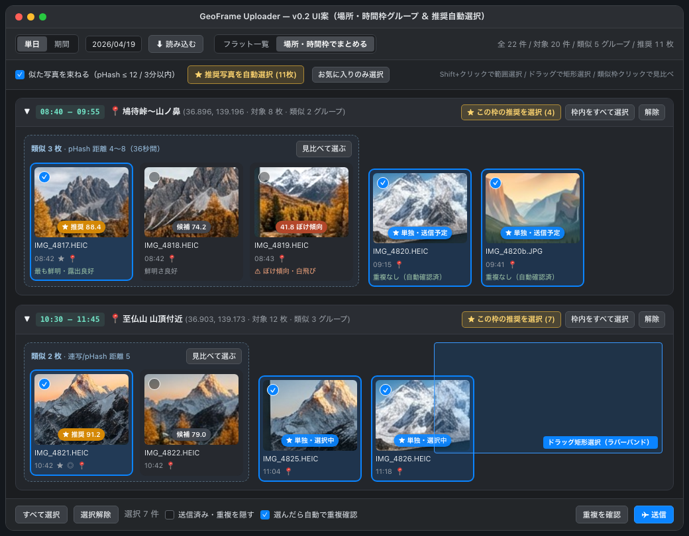
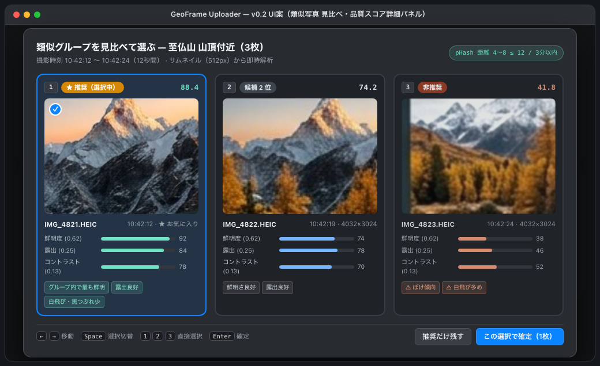

# v0.2 設計書：写真選択改善・場所/時間枠グルーピング・類似写真＆推奨自動選択

## 1. 背景と課題

v0.1 の一覧画面（[PhotoGridView.swift](../apps/GeoFrameUploader/Sources/GeoFrameUploader/Views/PhotoGridView.swift), [PhotoCell.swift](../apps/GeoFrameUploader/Sources/GeoFrameUploader/Views/PhotoCell.swift)）では、選択操作が「1 枚ずつクリック」と「すべて選択 / 選択解除」に限られており、連写や構図違いの似た写真が多い日、または 1 日に複数スポットを移動した日に選択の負担が発生していた。

1. 範囲選択ができず、数十枚の取捨選択でクリック回数が多い。
2. 時刻・撮影場所の区切りが無く、特定の時間帯・スポット単位でまとめて選べない。
3. 似た写真（連写・微調整ショット）がフラットに並ぶため、ベストショット 1 枚を見比べて選ぶのが大変。

本実装では、[ysogabe/geoframe](https://github.com/ysogabe/geoframe) の類似写真グルーピングおよび品質解析・代表選出アルゴリズムを `UploaderCore` に取り込み、**iCloud 上の原本ダウンロードを伴わない高速・低コストな選択支援**を実現している。

---

## 2. `ysogabe/geoframe` の調査結果（取り込み元仕様）

`ysogabe/geoframe`（`main` ブランチ）では、以下の 3 系統のロジックが実装されている。

### 2.1 似た写真のグルーピング（`crates/geoframe/src/quality.rs`, `quality/features.rs`, `quality/group.rs`）
- **アルゴリズム識別子**: `ALGORITHM = "rust-phash-v1:t3:h12"`
- **pHash（64-bit 知覚ハッシュ）計算**:
  1. 中央正方形クロップ（`fit_box`）
  2. グレースケール（`Luma`）で `PHASH_SIZE × PHASH_SIZE`（`32 × 32`）へ `Lanczos3` 縮小
  3. 2D Type-II DCT の左上 `PHASH_LOW × PHASH_LOW`（`8 × 8`）係数を計算
  4. DC 成分 `coeffs[0]` を除いた 63 個の AC 係数の中央値 `median` を算出
  5. `c > median` なら `1`、それ以外は `0` として MSB-first で 64-bit 整数にパック
- **クラスタリング（`build_quality_rows`）**:
  - 撮影日時 `taken_at` 昇順で走査し、`UnionFind`（単連結成分）で束ねる。
  - **同一ファイル**: `content_sha256` 一致で結合（`group_kind = "exact"`）。
  - **類似写真**: スライディングウィンドウ内で `at - prev_at <= TIME_WINDOW_S`（`180` 秒 = 3 分）かつハミング距離 `(phashA ^ phashB).count_ones() <= PHASH_DISTANCE`（`12`）を満たすペアを結合（`group_kind = "similar"`）。
  - *備考*: `ai/groups.rs`（CLIP 等埋め込みベクトル、`window_s = 900` s、cosine `>= 0.83`）も存在するが、Upload 前段のローカルアプリには外部モデル不要な **`rust-phash-v1:t3:h12`** が適している。

### 2.2 品質解析と推奨選出（`quality/features.rs`, `quality/group.rs`, `selection.rs`, `ai/search_view.rs`）
- **解析解像度**: 長辺が `METRIC_PX = 512` を超える場合は `512 px` へグレースケール縮小（解像度自体はスコアに含めない）。
- **算出指標（`image_metrics`）**:
  - 256 ビン輝度ヒストグラムから `luminance`（平均輝度）、`black_clip`（`[0..8]` 割合）、`white_clip`（`[248..256]` 割合）、`contrast`（95%点 − 5%点）を計算。
  - **鮮明度 `sharpness`**: 3×3 ラプラシアン風エッジフィルタ `(8 * center - sum_of_8_neighbors).clamp(0, 255)` をかけ、外周 4 px を除いた分散から $\ln(1 + \text{variance})$ を算出。
  - **露出スコア `exposure_score`**:
    - `center_score = 100.0 * exp(-((luminance - 128.0) / 100.0)^2)`
    - `clip_penalty = min((black_clip + white_clip) * 260.0, 55.0)`
    - `low_contrast_penalty = max(45.0 - contrast, 0.0) * 0.45`
    - `exposure_score = clamp(center_score - clip_penalty - low_contrast_penalty, 0.0, 100.0)`
- **グループ内スコアリング（`rank_metrics`）**:
  - グループ内で `sharpness`, `exposure_score`, `contrast` を Min-Max 正規化（差が極小なら `0.5`）。
  - `exposure_rel = 0.55 * (exposure_score / 100.0) + 0.45 * normalize(exposure_score)`
  - `clip_penalty = min((black_clip + white_clip) * 0.8, 0.20)`
  - $\text{score} = \text{round1}(100.0 \times \text{clamp}(0.62 \cdot \text{sharp\_rel} + 0.25 \cdot \text{exposure\_rel} + 0.13 \cdot \text{contrast\_rel} - \text{clip\_penalty},\ 0.0,\ 1.0))$
- **診断ラベル**:
  - 問題タグ: `sharpness < median * 0.82`（`ぼけ傾向`）、`exposure_score < 45.0`（`露出要確認`）、`white_clip > 0.08`（`白飛び多め`）、`black_clip > 0.15`（`黒つぶれ多め`）、`contrast < 45.0`（`低コントラスト`）
  - 推奨理由タグ: `sharpness >= max * 0.98`（`グループ内で最も鮮明`） / `>= median`（`鮮明さ良好`）、`exposure_score >= 75.0`（`露出良好`）、`black_clip + white_clip < 0.015`（`白飛び・黒つぶれ少`）
- **お気に入り（`favorite`）の扱い**:
  - `quality/group.rs` 単体は `score` 降順で `pool.iter().take(2)` を `recommended` にする一方、`selection.rs`（配信抑制免除）や `ai/search_view.rs`（ソート最上位）・`blog.rs`（`+0.25` 加点）では `favorite` が最優先される。

### 2.3 場所・時間枠・位置補完（`photos.rs`, `geo/infer.rs`, `geo/enrich.rs`）
- `geoframe` 本体は長期間のカタログ向けに `TRIP_GAP_SECONDS = 48 * 3600` で旅分割を行う（Haversine クラスタリングは持たない）。
- 位置情報欠落時は時刻最近傍アンカー（既定最大 12 時間以内）から座標を推定し、逆ジオコーディングキャッシュは `geo:{lat:.3},{lon:.3}`（約 100 m 粒度）をキーにしている。

---

## 3. GeoFrame Uploader への取り込み処理方式（Fable レビュー反映版）

### 基本方針：原本をダウンロードせず「メタデータ + 512px サムネイル」で完結させる
`OriginalExporter` が扱う `.photo` 原本は数 MB〜数十 MB あり一覧表示時の全枚数解析には向かない。`PhotoLibrary` が `PHCachingImageManager` で取得する **長辺最大 512 px サムネイル `CGImage`**（`.aspectFit` / `.exact` / `.highQualityFormat`）と、`PhotoItem` が保持するメタデータだけで全ステージを実行する（iCloud 最適化ライブラリ環境では 512 px サムネイルのみネットワーク取得を許可し、取得失敗時は未解析として安全にスキップする）。解析用画像は GUI の `ThumbnailCache`（320 px 用 `NSCache`）には載せず、解析後に即座に破棄する。

### Stage 1：場所 × 時間枠の即時グルーピング（メタデータのみ・0 ms）
`PhotoLibrary.fetchItems` 完了直後に `PhotoSectioner`（純粋関数）を実行する。`items` 全体（`(creationDate, localIdentifier)` 安定ソート）に対して計算し、`hideDone` 絞り込みは表示時に行う（自動重複確認でセクション境界が跳ねないため）。

1. **境界判定（実 GPS 同士のみで比較）**:
   - `creationDate == nil` のアセットは末尾の「日時不明」セクションへまとめる（現行 `PHFetchOptions` では除外されるが純粋関数として保証）。
   - 日時ありの写真は、以下のいずれかを満たしたら新しい `PhotoSection` を開始する（セクション ID は先頭写真の `localIdentifier`）。
     - **時間ギャップ**: 直前の写真から既定 **30 分** 超（UI で `15分 / 30分 / 60分` 切替可、`UserDefaults` 保存）
     - **移動距離（Haversine）**: セクション内で直近に実 GPS を持つ写真からの距離が `max(距離閾値, accA + accB)` 超（既定 **300 m**、UI で `100m / 300m / 1km` 切替可、`UserDefaults` 保存）。片側または両側に実 GPS が無い場合は距離境界を作らない。
     - *数値安全性*: 座標妥当性（`|lat| <= 90 && |lon| <= 180`）を検証し、Haversine の `a` を `[0, 1]` にクランプする（対蹠点や 180° 経線跨ぎでも NaN にならない）。
2. **欠落 GPS の表示用一時補完**:
   - セクション内に実 GPS が 1 枚も無い場合に限り、全 `items` 中で前後 `±2 時間` 以内の最近傍実 GPS を**表示名用代表座標**として借用する（`PhotoItem.location` や境界判定には一切書き込まない）。
3. **セクション表示名と逆ジオコーディング（`PlaceNameResolver`）**:
   - 時刻表示は単日なら `HH:mm – HH:mm`、複数日または日跨ぎ時は `MM/dd HH:mm – HH:mm` とする。
   - 「地名を表示」トグル（既定オン、`UserDefaults` 保存）がオンのとき、`GeocodingBackend`（本番は `CLGeocoder`）をラップした `PlaceNameResolver` が代表座標の地名をバックグラウンド解決する（丸めた座標を Apple のジオコーディングサービスへ送信する旨をドキュメントに明記）。
   - **明示的直列キュー**: 同時実行 1 厳守・未キャッシュ連続時 `300 ms` 間隔、`withTaskCancellationHandler` で `cancelGeocode()` を呼び、レート制限エラー時は残りのキューを停止する。
   - **キャッシュ設計**: `-0.0005 < v < 0.0005` を `0` に丸め、`ja:%.3f,%.3f`（POSIX ロケール）をキーに `place-cache.json`（権限 `0600`、`atomicWrite0600`）へ永続化する。Apple のジオコーディングバックエンド（`CLGeocoderBackend`）にもこの丸めた約 100 m 精度の座標のみを送信し、`lastBackendQueryAt` でワーカー再開を跨いだ最小 300 ms 間隔を保ち、世代 ID でキャンセル後の遅延応答を破棄する。「結果なし（海上等）」はセッション内メモリに否定キャッシュし、通信エラー・キャンセルは永続キャッシュしない。

### Stage 2：サムネイル並列解析による類似グルーピング（`ImageQualityAnalyzer` & `QualityCache`）
1. **解析用画像の正規化**: `CGImage` を `genericGrayGamma2_2`（ガンマ 2.2・8-bit グレースケール・黒塗り背景）へ描画して標準化し、長辺が `512` 超の場合のみ長辺 `512 px` へ縮小する（`512` 以下は拡大しない）。
2. **pHash & QualityMetrics 算出（`rust-phash-v1:t3:h12` 準拠の Swift 移植）**:
   - **pHash**: 中央正方形クロップ → `32×32` 縮小 → 正規化なしの素の 2D Type-II DCT（左上 `8×8`）→ `coeffs[1..<64]` を昇順ソートした添字 31 を `median` とし、`coeffs[0..<64]` を `c > median` で MSB-first 64-bit パック。単色/平坦画像（`max(|AC|) < 1e-3`）は `pHash = nil` とし偽一致を防ぐ。
   - **QualityMetrics**: 256 ビン輝度ヒストグラム（`luminance`, `blackClip`, `whiteClip`, `contrast` P95−P05）、3×3 ラプラシアンエッジ分散 $\ln(1+\text{var})$（`w < 3 || h < 3` は元画素、外周 4 px 除外は `w > 8 && h > 8` のみ）、`exposureScore` を算出。全 `Double` 値の `.isFinite` を検証し、非有限があれば失敗（`nil`）として保存しない。
   - *非目標*: サムネイル入力・リサイズ補間が異なるため、サーバー側（GEOFRAME 本体）の原本/表示画像から算出したビット列との完全一致は保証しない。
3. **キャッシュ分離（`quality-cache.json`）**:
   - 送信状態の `item-cache.json` とは分離し、`~/Library/Application Support/GeoFrameUploader/quality-cache.json`（権限 `0600`・フォーマット v2・バッチ保存）へ保存する。
   - 無効化キーは `(originalFilename, uti, pixelWidth, pixelHeight, modificationTimestamp: Double?, algorithmVersion: "swift-phash-v1:t3:h12:m512")` とし、Photos でトリミング・露出編集されるとサブ秒精度で再解析する。
4. **セクション内類似クラスタリング（`SimilarityGrouper`）**:
   - 類似クラスタは**各セクション内**に限定し（セクション境界を跨がない）、対象（`eligibility.isEligible`）写真を撮影時刻昇順で `UnionFind` 結合する：
     - **条件 A**: `burstIdentifier` が非 nil で一致する
     - **条件 B**: `|tA - tB| <= 180 秒` かつ双方が有効 `pHash` を持ち `(pHashA ^ pHashB).nonzeroBitCount <= 12`

### Stage 3：推奨写真の自動選択ロジック ＆ ライフサイクル管理
- **類似グループ（2 枚以上）内での順位付け（`isDone` を含む全対象写真で評価）**:
  1. `isFavorite == true` を最優先（お気に入りが複数あればその中で `score` 降順）
  2. `geoframe` 移植の `rank_metrics` 重み（`0.62 * sharp_rel + 0.25 * exposure_rel + 0.13 * contrast_rel - clip_penalty`、`normalize` の同値判定は相対誤差 `1e-9` で `0.5`、`round1` は小数第 1 位丸め）による `score` 降順
  3. 同一スコアのタイブレーク: 解像度（`pixelWidth * pixelHeight`）→ `creationDate` 昇順 → `localIdentifier` 昇順（送信物が編集前 `.photo` のため `hasAdjustments` はタイブレークに使わない）
- **推奨の自動選択ルール**:
  - **クラスタ内**: 順位 1 位（および同グループ内の他の `isFavorite`）が `isDone`（送信済み・Drive 既存）なら、そのクラスタからは何も自動選択しない（2 番手を繰り上げ送信しない）。未送信ならその 1 枚（または複数お気に入り）を選択対象とする。
  - **単独写真**: 解析済みかつ重大な絶対品質不良（`exposureScore < 35.0 || whiteClip > 0.20 || blackClip > 0.30 || sharpness < 2.5`）が無く、`isDone` でない写真を含める。未解析（解析途中・サムネイル取得失敗）の写真は自動推奨に含めない。
  - **一括選択の意味**: 上部バーの **`推奨を自動選択`** は `selection` を**置換**、セクション見出しの **`推奨を選択`** と **`枠内をすべて選択`** は `selection` に**追加**、**`解除`** はそのセクション分を**除外**する。
  - 既存の「選んだら自動で重複確認」とは `selection` 一括更新（`300 ms` デバウンス）で連携し、20 件超送信時は既存の確認ダイアログが出る。
- **バックグラウンド解析と終了処理（`AppModel`）**:
  - 解析中は `isBusy` を立てず手動選択を妨げない。`analysisGeneration` で世代管理し、`load()` 再実行時は古い世代を破棄する。
  - 解析タスクと地名解決タスクは `hasActiveWork` / `stopForTermination` の完了待ち対象に含めず、`load()` 時・終了時は `cancel()` のみで即座に終了する。

---

## 4. 写真選択 UX の改善と画面構成

### 実装した選択操作
1. **ワンクリック推奨選択**: 上部バーの **`推奨を自動選択`** で、全セクションの未送信推奨写真だけを一括選択（既存選択を置換）。セクションごとの **`推奨を選択`** でも追加選択可能（品質解析の完了後に有効化）。
2. **場所 × 時間枠セクション一括操作**: セクションごとに折りたたみ（見出しに選択数バッジを表示）、**`枠内をすべて選択`** / **`解除`** を配置。
3. **`Shift + クリック` 範囲選択**:
   - `AppModel` に `lastClickedId: String?` を保持し（`load()` や起点非表示時はリセット）、セル全体タップとチェックボックスの両方で `NSEvent.modifierFlags.contains(.shift)` を受け取り、`SelectionPlanner.shiftRange`（純粋関数）で表示中の対象セル区間を起点の状態に合わせて一括選択／解除する（折りたたみ済みセクション内の写真は含めない）。
4. **類似写真の「見比べパネル」＆ キーボード操作**:
   - 類似グループ枠の **`見比べて選ぶ`** から横並び拡大表示（7 枚以上のクラスタは 6 枚ごとにページ送り）し、`← / →`、`Space`（選択切替）、`1〜9`（番号指定切替）、`Enter`（確定・パネル内選択を反映）、`Esc`（キャンセル）、「推奨だけ残す」で素早く吟味できる。

### 画面構成 1：場所・時間枠セクション表示 ＆ 類似スタック・推奨自動選択

### 画面構成 2：類似写真グループの見比べ・品質スコア詳細パネル

---

## 5. `UploaderCore` / `GeoFrameUploader` の実装コンポーネント

| レイヤー | ファイル | 役割 |
|---|---|---|
| `UploaderCore` | `PhotoSectioner.swift` | 時刻ギャップ + Haversine 距離（実 GPS のみ）+ 表示用 GPS 補完によるセクション分割 |
| `UploaderCore` | `PlaceNameResolver.swift` | `GeocodingBackend`（`CLGeocoderBackend`）直列キュー＋`place-cache.json`（0600・失敗非キャッシュ・世代ガードキャンセル） |
| `UploaderCore` | `ImageQuality.swift` | 512px ガンマ 2.2 グレースケール pHash（64-bit DCT）・品質指標算出・`QualityCache`（`quality-cache.json`、format v2） |
| `UploaderCore` | `SimilarityGrouper.swift` | セクション内 `UnionFind` 類似クラスタリング・順位付け・推奨選出・`SelectionPlanner`（`shiftRange`） |
| `UploaderCore` | `PhotoItem.swift`, `PhotoLibrary.swift`, `AppPaths.swift`, `ResultCache.swift`, `UploaderService.swift` | `modificationDate`、512px 解析画像取得、`qualityCacheFile`/`placeCacheFile`、`atomicWrite0600` 再利用、解析窓口 |
| `GeoFrameUploader` | `AppModel.swift` | `groupingMode`（場所・時間枠 / フラット一覧）、`bundleSimilar`、閾値設定、地名表示トグル、推奨選択・`Shift` 範囲選択・世代管理 |
| `GeoFrameUploader` | `Views/DateFilterView.swift`, `PhotoGridView.swift`, `PhotoCell.swift`, `SimilarCompareView.swift`, `ContentView.swift` | 選択ツールバー、セクションヘッダー、類似グループ枠、`Shift` クリック、見比べモーダル UI |
